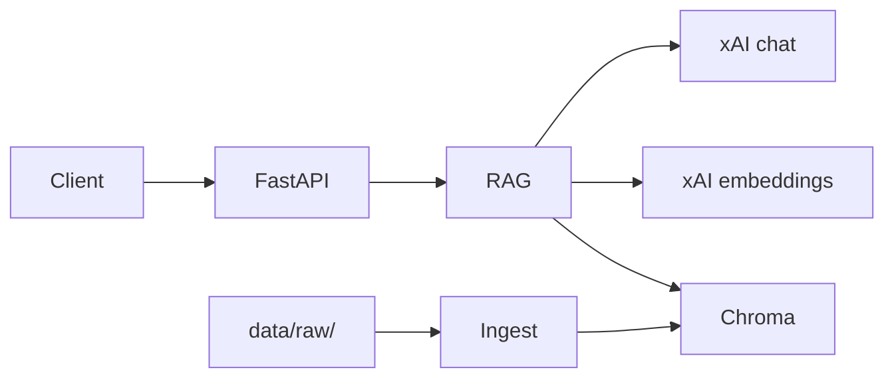

# rag-api-demo

Versioned **RAG HTTP API**: FastAPI, local Chroma, xAI Grok embeddings + chat, citations and usage metrics.

[](https://github.com/tarmosalong/rag-api-demo/actions/workflows/ci.yml)

**Stack:** Python 3.12 · FastAPI · Chroma · xAI (OpenAI-compatible) · Docker · GitHub Actions

## Zero-cost local workflow (no xAI credits)

No API key or billing required:

```bash
cp .env.example .env   # leave XAI_API_KEY placeholder; set RAG_OFFLINE=1
make install
make seed-offline      # Chroma index with hash-based vectors (no network)
make dev-offline       # UI http://127.0.0.1:8765/ (OpenAPI: /docs)
make test && make eval
```

`POST /v1/ask` with `RAG_OFFLINE=1` (default `RAG_OFFLINE_MODE=retrieve`) answers from your indexed docs via **keyword retrieval + extractive snippets** — no chat or embed API calls. Set `RAG_OFFLINE_MODE=mock` for the fixed contract-test string only.

## Quick demo (live xAI)

```bash
cp .env.example .env    # set XAI_API_KEY, RAG_OFFLINE=0
make install && make ingest
make dev                  # OpenAPI http://127.0.0.1:8765/docs
```

```bash
curl -s -X POST http://127.0.0.1:8765/v1/ask \
  -H 'Content-Type: application/json' \
  -d '{"question":"What is the project name?"}' | jq
```

Example response fields: `answer`, `sources[]` (file, score, snippet), `usage`, `latency_ms`, `request_id`.

`POST /v1/upload` is optional; prefer `make ingest` for the committed corpus.

## Setup

```bash
cp .env.example .env
make install
make lint && make test    # RAG_OFFLINE=1, no API key
```

`INGEST_ON_STARTUP=false` by default — run `make ingest` before the first live question (including Docker).

**Windows (no `make` required):**

```powershell
copy .env.example .env
.\scripts\install.cmd
.\scripts\dev-offline.cmd
```

If scripts are blocked, use `.cmd` wrappers (they bypass execution policy) or:

`powershell -NoProfile -ExecutionPolicy Bypass -File .\scripts\install.ps1`

Open http://127.0.0.1:8765/ (or set `$env:PORT='18765'` if Windows reports WinError 10013 on 8765). Tests: `$env:RAG_OFFLINE="1"; .\.venv\Scripts\python.exe -m pytest -q`

**Windows + Python 3.12:** PyPI has no `chroma-hnswlib==0.7.6` wheel, so `install.ps1` uses the **0.7.5** wheel then installs `chromadb` without building C++. Alternative: use **Python 3.11** (3.11 has a 0.7.6 wheel) or install [MSVC Build Tools](https://visualstudio.microsoft.com/visual-cpp-build-tools/).

## Architecture



Details: [docs/ARCHITECTURE.md](docs/ARCHITECTURE.md) · HTTP examples: [docs/requests.http](docs/requests.http)

## Sample questions (corpus)

| Question | Expected fact | `expected_source` |
|----------|---------------|-------------------|
| What is the project name? | `rag-api-demo` | `project-overview.md` |
| Which vector store is used? | Chroma | `project-overview.md` |
| Default `INGEST_ON_STARTUP`? | false | `operations-handbook.txt` |
| Cost per ask? | embedding + chat | `operations-handbook.txt` |

Run checks: `make eval` (offline contract) or `make eval-live` (retrieval + xAI, costs tokens).

## Cost (xAI)

| Workload | Calls |
|----------|--------|
| Ingest new chunk | 1 embedding (batched); cache skips unchanged chunks |
| Each `/v1/ask` | 1 question embedding + 1 chat (every time) |
| 100 asks (illustration) | ~100×(embed + chat) — ingest separate |
| CI | 0 (`RAG_OFFLINE=1`) |

Limits: `MAX_OUTPUT_TOKENS`, `MAX_CONTEXT_CHARS`. Embed cache applies to **ingest chunks only**, not question embeddings.

## Security (local default)

- No auth on `ask` / `upload` for local development.
- Optional `API_KEY` — not enabled in this repo (phase 2).
- Upload capped at 5 MB; sync ingest on upload.

## Operations

| Command | Purpose |
|---------|---------|
| `make dev` | Uvicorn on port **8765** |
| `make ingest` | Rebuild index from `data/raw/` |
| `make docker` | `docker compose up --build` |
| `make eval` | Offline eval (`eval.json`) |
| `make eval-live` | Live eval (requires key + ingest) |

If xAI returns **404** for a model name, update `CHAT_MODEL` / `EMBED_MODEL` in `.env` per the current model list.

## Manual live eval (GitHub)

Optional workflow [`.github/workflows/rag-live.yml`](.github/workflows/rag-live.yml): **Actions → rag-live → Run workflow** (requires repo secret `XAI_API_KEY`). This is not part of the CI badge and consumes tokens.

## Implementation status

| Step | Deliverable |
|------|----------------|
| 0 | Repo layout, deps, sample `data/raw/` |
| 1–2 | RAG core, `/v1` API, offline tests |
| 3–4 | Docker, `ci.yml` (offline) |
| 5–6 | `ARCHITECTURE.md`, `eval.json`, `make eval` |

Phase 2 (not implemented): PDF ingest, rate limiting, GHCR publish.

## Contributing

English only in git — see [docs/CONTRIBUTING.md](docs/CONTRIBUTING.md).