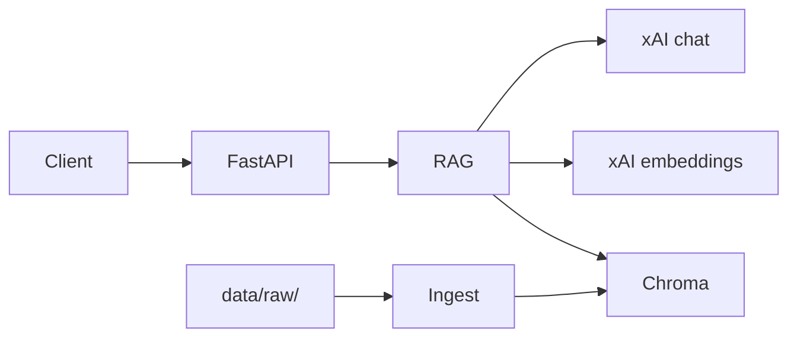

# rag-api-demo

A small **retrieval-augmented generation (RAG) HTTP API** and browser UI: ingest Markdown/text into **Chroma**, answer questions with **citations**, token **usage**, and request **latency**. Live mode uses **xAI Grok** (OpenAI-compatible embeddings + chat). **Offline mode** runs with zero API spend for local dev, tests, and CI.

[](https://github.com/tarmosalong/rag-api-demo/actions/workflows/ci.yml)

**Stack:** Python 3.12 · FastAPI · Chroma · xAI · Docker · GitHub Actions

## Features

- **REST API** — `POST /v1/ask` with `answer`, `sources[]`, `usage`, `latency_ms`, `request_id`
- **Web UI** — static front end at `/` (health + stats in the toolbar)
- **Ingest** — `make ingest` or `POST /v1/upload` (`.txt` / `.md`, 5 MB cap)
- **Offline RAG** — hash-based vectors + keyword/extractive answers (`RAG_OFFLINE=1`)
- **Embed cache** — SQLite cache skips unchanged chunks on re-ingest
- **Eval harness** — `eval.json` + `make eval` / `make eval-live`

## API overview

| Method | Path | Description |
|--------|------|-------------|
| `GET` | `/health` | Liveness + `index_ready` |
| `GET` | `/v1/stats` | Document/chunk counts |
| `POST` | `/v1/ask` | Question → answer + sources |
| `POST` | `/v1/upload` | Upload file and ingest |
| `GET` | `/` | Web UI |
| `GET` | `/docs` | OpenAPI (Swagger) |

## Zero-cost local workflow (no xAI key)

```bash
cp .env.example .env   # RAG_OFFLINE=1; XAI_API_KEY can stay a placeholder
make install
make seed-offline      # Chroma index with hash-based vectors (no network)
make dev-offline       # UI http://127.0.0.1:8765/
make test && make eval
```

With `RAG_OFFLINE=1`, default `RAG_OFFLINE_MODE=retrieve` returns real excerpts from the index (keyword retrieval + snippets). Set `RAG_OFFLINE_MODE=mock` only for the fixed contract-test string.

`RAG_AUTO_SEED_OFFLINE=true` (default in `.env.example`) rebuilds the index from `data/raw/` on startup when offline and the index is missing or stale.

## Live demo (xAI)

```bash
cp .env.example .env    # XAI_API_KEY, RAG_OFFLINE=0
make install && make ingest
make dev                 # http://127.0.0.1:8765/docs
```

```bash
curl -s -X POST http://127.0.0.1:8765/v1/ask \
  -H 'Content-Type: application/json' \
  -d '{"question":"What is the project name?"}' | jq
```

`INGEST_ON_STARTUP=false` by default — run `make ingest` before the first live question (including Docker).

## Configuration

Copy `.env.example` to `.env`. Common variables:

| Variable | Purpose |
|----------|---------|
| `XAI_API_KEY` | xAI API key (live mode) |
| `CHAT_MODEL` / `EMBED_MODEL` | Grok model names |
| `CHROMA_PATH` | Chroma persist dir (`data/chroma`) |
| `TOP_K` | Chunks retrieved per question |
| `RAG_OFFLINE` | `1` = no xAI calls |
| `RAG_OFFLINE_MODE` | `retrieve` or `mock` |
| `RAG_AUTO_SEED_OFFLINE` | Auto-ingest `data/raw/` when offline |

Full list: `.env.example`.

## Windows

No `make` required:

```powershell
copy .env.example .env
.\scripts\install.cmd
.\scripts\dev-offline.cmd
```

If PowerShell blocks scripts, use the `.cmd` wrappers or:

`powershell -NoProfile -ExecutionPolicy Bypass -File .\scripts\install.ps1`

- **Default port:** `18765` on Windows (`8765` is often reserved — set `$env:PORT` if needed).
- **Tests:** `$env:RAG_OFFLINE="1"; .\.venv\Scripts\python.exe -m pytest -q`
- **Chroma DLL errors:** install [VC++ Redistributable x64](https://aka.ms/vs/17/release/vc_redist.x64.exe) (`winget install Microsoft.VCRedist.2015+.x64`).
- **Python 3.12:** `install.ps1` pins `chroma-hnswlib==0.7.5` (no 0.7.6 wheel on Windows), then installs `chromadb` with `--no-deps`. Python 3.11 is an alternative.

Manual start (same as `dev-offline.ps1`):

```powershell
$env:RAG_OFFLINE="1"; $env:RAG_AUTO_SEED_OFFLINE="true"
.\.venv\Scripts\python.exe -m uvicorn src.main:app --host 127.0.0.1 --port 18765
```

## Project layout

```
src/           FastAPI app, RAG, ingest, Chroma
static/        Web UI (HTML/CSS/JS)
data/raw/      Sample corpus (committed)
tests/         Pytest (offline by default)
scripts/       Windows install/dev, eval runner
docs/          Architecture, HTTP examples, contributing
```

## Architecture



More detail: [docs/ARCHITECTURE.md](docs/ARCHITECTURE.md) · Examples: [docs/requests.http](docs/requests.http)

## Sample questions (bundled corpus)

| Question | Expected fact | `expected_source` |
|----------|---------------|-------------------|
| What is the project name? | `rag-api-demo` | `project-overview.md` |
| Which vector store is used? | Chroma | `project-overview.md` |
| Default `INGEST_ON_STARTUP`? | false | `operations-handbook.txt` |
| Cost per ask? | embedding + chat | `operations-handbook.txt` |

`make eval` (offline) or `make eval-live` (retrieval + xAI; costs tokens).

## Cost (live xAI)

| Workload | API calls |
|----------|-----------|
| Ingest (new chunk) | 1 embedding per batch; cache skips unchanged chunks |
| Each `POST /v1/ask` | 1 question embedding + 1 chat completion |
| CI / offline dev | 0 (`RAG_OFFLINE=1`) |

Caps: `MAX_OUTPUT_TOKENS`, `MAX_CONTEXT_CHARS`. Embed cache applies to **ingest chunks only**, not per-question embeddings.

## Security (local default)

- No auth on `ask` / `upload` (local development).
- Optional `API_KEY` is documented for a future phase — not wired in this repo.
- Upload limited to 5 MB; ingest runs synchronously on upload.

## Operations

| Command | Purpose |
|---------|---------|
| `make dev` | Uvicorn `:8765` (live `.env`) |
| `make dev-offline` | Uvicorn with `RAG_OFFLINE=1` |
| `make ingest` | Rebuild index from `data/raw/` |
| `make seed-offline` | Same with hash embeddings |
| `make docker` | `docker compose up --build` |
| `make eval` | Offline eval (`eval.json`) |
| `make eval-live` | Live eval (key + ingest) |

If xAI returns **404** for a model id, update `CHAT_MODEL` / `EMBED_MODEL` in `.env`.

## CI and optional live eval

- **CI** — [`.github/workflows/ci.yml`](.github/workflows/ci.yml) runs lint + tests with `RAG_OFFLINE=1` (badge above).
- **Manual live eval** — [`.github/workflows/rag-live.yml`](.github/workflows/rag-live.yml): Actions → **rag-live** → Run workflow (repo secret `XAI_API_KEY`; uses tokens).

## Roadmap

| Done | Notes |
|------|--------|
| RAG core, `/v1` API, offline tests | Steps 0–2 |
| Docker, offline CI | Steps 3–4 |
| Architecture doc, `eval.json` | Steps 5–6 |

**Not in scope yet:** PDF ingest, rate limiting, GHCR publish, API-key middleware.

## Contributing

Git-tracked content is **English only** — see [docs/CONTRIBUTING.md](docs/CONTRIBUTING.md).