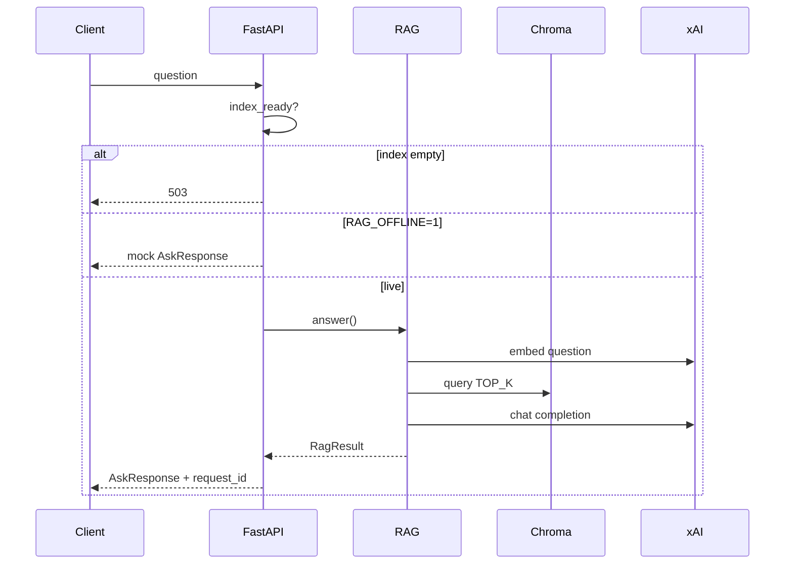

# Architecture

## Components

| Layer | Module | Role |
|-------|--------|------|
| HTTP | `src/main.py`, `src/schemas.py` | Versioned REST (`/v1/*`), Pydantic contracts |
| RAG | `src/rag.py`, `src/ingest.py` | Chunk, embed, retrieve, chat completion |
| Store | `src/chroma_store.py`, `data/chroma/` | Persistent vector index (`rag_docs`) |
| Cache | `src/embed_cache.py`, `data/embed_cache.sqlite` | Content-hash → embedding (ingest only) |
| xAI | `src/xai_client.py` | OpenAI-compatible client (`XAI_BASE_URL`) |
| Ops | `src/middleware.py` | `X-Request-Id` on every response |

## Request flow (`POST /v1/ask`)

## Ingest flow

1. Read `data/raw/*.md` and `*.txt`.
2. Chunk (~900 chars, 150 overlap) via `src/chunking.py`.
3. For each chunk: lookup hash in SQLite cache; batch-embed misses via xAI.
4. Upsert into Chroma with metadata `source`, `doc_id`, `chunk_id`.

Incremental ingest replaces chunks for a single `doc_id` (upload or `--file`).

## Cost model

| Operation | xAI calls |
|-----------|-----------|
| Ingest (per new chunk) | 1 embedding (batched) |
| Re-ingest unchanged chunk | 0 (SQLite cache) |
| Each `ask` | 1 question embedding + 1 chat |
| CI (`RAG_OFFLINE=1`) | 0 |

Guards: `MAX_OUTPUT_TOKENS`, `MAX_CONTEXT_CHARS`, `TOP_K` (retrieval breadth).

Question embeddings are **not** cached in this project.

## Offline development

`python -m src.ingest --offline` (or `make seed-offline`) builds Chroma from `data/raw/` using deterministic hash embeddings — **zero xAI calls**. Pair with `RAG_OFFLINE=1` for API responses that satisfy the `AskResponse` contract without chat/embed billing.

## Configuration

All settings via `.env` (see `.env.example`). Secrets never committed.

`INGEST_ON_STARTUP=false` by default — run `make ingest` before the first live `ask`.